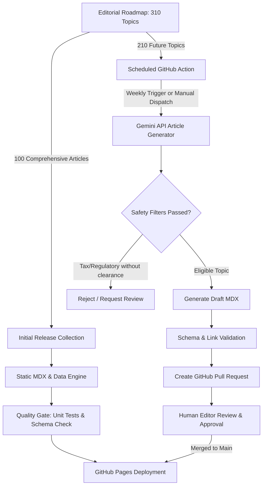

# Automated AI Publishing & Editorial Governance Pipeline

## 1. Governance Principles
ArthaAtlas P2P employs automated AI generation strictly as an **editorial drafting and research accelerator**, bounded by strict algorithmic safety gates.

Because P2P lending intersects with statutory financial regulations (RBI Directions) and taxation liabilities (Income Tax Act), automated generation must never publish unvetted assertions or fabricated yields.

---

## 2. Dual-Workflow Architecture

### Workflow A: Initial Bulk Generation
- **Executed by Antigravity directly**: 100 comprehensive research articles generated, tested, and indexed.
- **Permanent Version Control**: All 100 articles stored as static `.mdx` files with full schema compliance.
- **Zero Runtime Dependencies**: The published website operates with zero AI API keys or recurring cloud fees.

### Workflow B: Scheduled Roadmap Automation (`generate-articles.yml`)
- **Cadence**: Weekly automated run (Mondays 04:00 UTC) or manual trigger via `workflow_dispatch`.
- **Target Selection**: Picks the highest priority unwritten topic from `src/data/roadmap.ts`.
- **API Provider**: Google Gemini API via official endpoint (`gemini-1.5-pro` or `gemini-2.0-flash`).
- **Cost & Budget Limits**: Configurable parameter `ARTICLES_PER_RUN` (default: 1) prevents runaway API bills.
- **Strict Approval Gate**: By default, `REQUIRE_MANUAL_APPROVAL` creates a GitHub Pull Request rather than pushing to production directly.

---

## 3. Safety Guardrails & Validation Checks

Before any generated article can merge, the CI pipeline enforces five automated verification gates:

1. **Schema Integrity**:
   - Title length between 20 and 100 characters.
   - Valid series ID matching `src/data/taxonomy.ts`.
   - Complete frontmatter including author, date, reading time, and summary.
2. **Citation Verification**:
   - Every source cited in `sources: ['...']` must resolve to an active entry in `src/data/sources.ts`.
   - Broken or fabricated URLs are flagged as build errors.
3. **Regulatory & Tax Firewall**:
   - Tax and regulatory topics cannot be automatically published without manual editor review (`ALLOW_TAX_ARTICLES=false`, `ALLOW_REGULATORY_ARTICLES=false` by default).
4. **Mathematical Verification**:
   - All financial equations and sample calculations must pass the Vitest test suite (`npm run test:unit`).
5. **No Secret Leakage**:
   - API keys are injected via GitHub Actions secrets and never written to `.mdx` files, generated HTML, or commit messages.

---

## 4. Enabling Scheduled Generation in GitHub

To enable automated generation for the remaining 210 roadmap topics:
1. Navigate to your repository on GitHub: `https://github.com/chirag127/artha-atlas-p2p`.
2. Go to **Settings** > **Secrets and variables** > **Actions**.
3. Click **New repository secret**.
4. Set name as `GEMINI_API_KEY` and paste your Google AI Studio API key.
5. In **Actions** tab, locate **Scheduled AI Article Generation** and click **Run workflow**.
