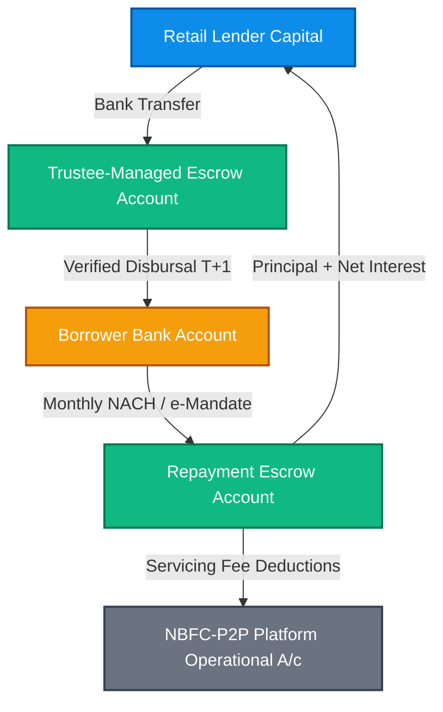

## Overview & Executive Summary

How the dual-escrow mechanism operated by a bank-promoted trustee ensures platforms never pool, hold, or touch investor capital.

Peer-to-peer (P2P) lending in India has undergone a profound regulatory and structural transformation. While early fintech marketing promoted marketplace loans as high-yield substitutes for bank deposits, the regulatory framework enforced by the Reserve Bank of India (RBI) firmly establishes that P2P lending is an **unsecured alternative credit asset class**. Lenders do not hold deposits; they act as individual credit grantors assuming full exposure to borrower creditworthiness.

## Core Operational Mechanics

- Platforms must maintain at least two separate escrow accounts: Disbursal Escrow and Repayment Escrow.
- Escrows must be operated exclusively by an independent bank-promoted trustee.
- Direct bank-to-bank flow: Lender Bank Account -> Disbursal Escrow -> Borrower Bank Account.
- Platform operational accounts are completely sequestered from escrow cash.

## Process & Flow Architecture

The following diagram illustrates the structural relationships and fund movements governing this topic:

## Indian Regulatory & Statutory Context

Under the RBI Master Directions for Non-Banking Financial Company – Peer to Peer Lending Platforms (updated August 16, 2024 via circular *RBI/2024-25/63*):

1. **Marketplace Intermediary Status:** An NBFC-P2P platform is strictly an information and facilitation intermediary. It is legally prohibited from taking credit risk on its own balance sheet or providing First Loss Default Guarantees (FLDG).
2. **Prohibition of Assured Returns:** Platforms cannot promise or advertise guaranteed minimum yields, tenure-linked certainty, or secondary market liquidity exit mechanisms.
3. **Statutory Exposure Ceilings:** No lender can lend more than **₹50,000** to a single borrower across all P2P platforms. Furthermore, aggregate lending across all platforms is capped at **₹50,00,000**, with mandatory CA net worth certification (minimum ₹50 lakh) required for any investor allocating more than ₹10,00,000.
4. **Escrow Bank Architecture:** All funds must flow through two trustee-managed escrow accounts operated by a bank-promoted trustee, ensuring committed cash moves strictly from lender bank to borrower bank within **T+1 day**.

## Taxation Implications: Section 56 vs Section 57

For retail lenders filing taxes in India:

- **Income Classification:** All interest income earned from P2P loans is chargeable under **"Income from Other Sources" (Section 56(2))** and taxed at the taxpayer's applicable marginal income tax slab rate (up to 30% plus 4% cess and applicable surcharge).
- **Deductible Fees (Section 57(iii)):** Upfront registration fees, monthly servicing commissions, and collection charges deducted by the platform are legitimate expenses incurred wholly and exclusively for earning interest income, and can be claimed as deductions.
- **The Asymmetric Tax Trap:** Unlike commercial moneylenders who can write off bad debts under Section 36(1)(vii), retail lenders cannot deduct lost loan principal under Section 57. You must pay tax on your gross interest received even if you suffer substantial principal write-offs in the same assessment year.

## Practical Due-Diligence Checklist

When evaluating or managing exposure related to this topic, follow this operational checklist:

- [ ] Verify that the platform holds an active Certificate of Registration (CoR) as NBFC-P2P on the official RBI website.
- [ ] Inspect the platform's published monthly NPA delinquency curves across seasoned historical cohorts.
- [ ] Calculate your true net realised return after deducting platform fees, expected defaults, and cash drag.
- [ ] Ensure single-borrower exposures remain strictly under ₹50,000 and represent less than 1% of your portfolio.
- [ ] Verify that your total P2P allocation across all platforms combined does not exceed 3%–5% of your liquid net worth.
- [ ] Maintain an archived ledger of all bilateral loan agreements, bank statements, and fee GST invoices for tax compliance.

## Frequently Asked Questions

### Can an NBFC-P2P platform guarantee my principal or returns?
**No.** Under RBI regulations, NBFC-P2P platforms are strictly prohibited from offering credit guarantees, default insurance, or assured returns. Lenders bear 100% of borrower default risk.

### How does the Asymmetric Tax Trap affect my real return?
Because the Income Tax Department treats P2P lending under "Income from Other Sources," you cannot deduct lost principal from your interest income. If you earn ₹15,000 in interest but lose ₹15,000 in defaulted principal, your economic gain is ₹0, yet you will still owe income tax on the ₹15,000 interest.

### What should I do if a borrower defaults completely?
The platform engages empanelled recovery agencies to pursue civil settlement, Lok Adalat proceedings, or Section 138 / Section 25 PASA actions. If all legal avenues are exhausted, the loan is written off. You must archive the loan contract and default notice for your permanent tax and accounting records.

## Official Sources & Legal Citations

- **Reserve Bank of India:** [Master Direction – Non-Banking Financial Company – Peer to Peer Lending Platform (Reserve Bank) Directions, 2017](https://www.rbi.org.in/Scripts/BS_ViewMasDirections.aspx?id=11137)
- **RBI Circular dated August 16, 2024:** [Review of Master Direction – NBFC-P2P Lending Platforms (RBI/2024-25/63)](https://www.rbi.org.in/Scripts/NotificationUser.aspx?Id=12724&Mode=0)
- **Income Tax Department:** [Section 56 & Section 57 of the Income Tax Act, 1961](https://incometaxindia.gov.in/)
